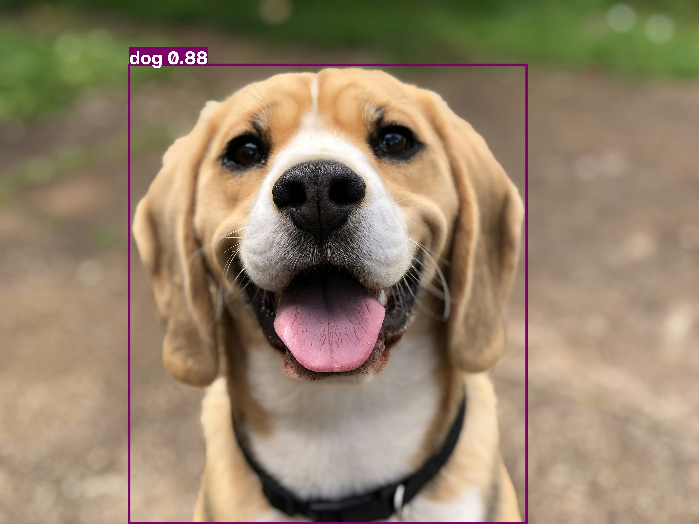
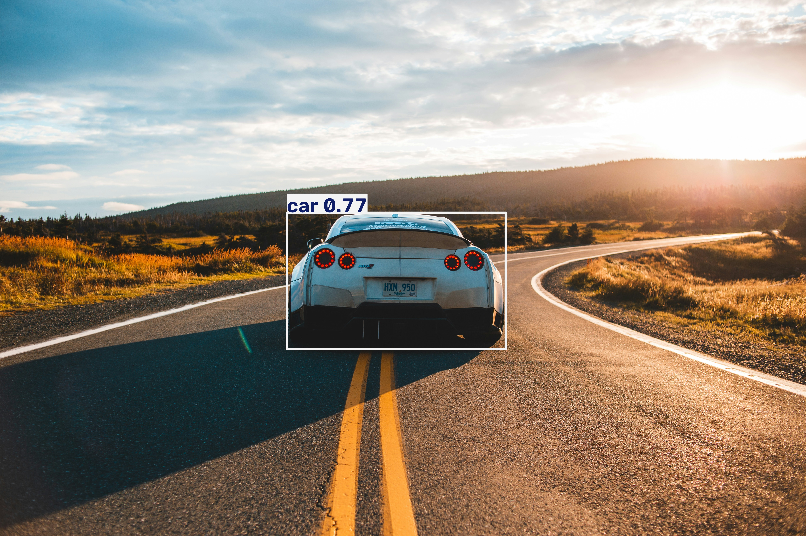
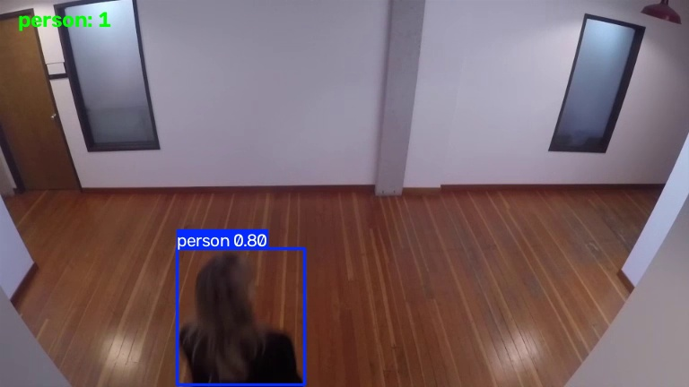

# YOLO DPL-CPV Concept Model

Implementation, code notebook, and evaluation package for the YOLO-based deep learning computer vision model.

---

## 💻 Source Code & Notebook

- **Jupyter Notebook**: [`YOLO.ipynb`](./YOLO.ipynb) — Contains model architecture, training, and execution workflow.

---

## 📄 Documentation & Report

- **Detailed Analysis**: Read the full report in [`report.md`](./report.md).

---

## 📷 Screenshots & Visual Results

| Sample Test 1 | Sample Test 2 | Video Frame Output |
| :---: | :---: | :---: |
|  |  |  |

---

## 👤 Author
- **GitHub**: [abhinavmeda07](https://github.com/abhinavmeda07)
